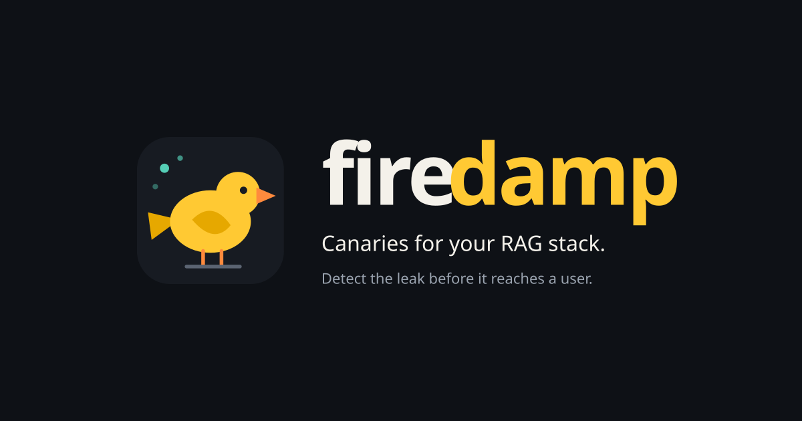

<p align="center">
  
</p>

<p align="center">
  <strong>Behavioral security regression and cross-tenant isolation testing framework for RAG & AI platforms.</strong>
</p>

<p align="center">
  <a href="wiki/CVE-Regression-Engine.md">🛡️ CVE Engine</a> •
  <a href="wiki/Version-Ladder-Benchmark.md">📊 Version Ladder</a> •
  <a href="#quickstart">⚡ Quickstart</a> •
  <a href="#live-validation">🔬 Live Validation</a> •
  <a href="tests/integration/openwebui_cve_2026_28788/README.md">🧪 Integration Lab</a> •
  <a href="CVE_AUDIT.md">📋 CVE Audit</a>
</p>

---

```text
                       .---.
                      /     \
                     | () () |    "If the canary falls silent,
                      \  ^  /      there is gas in the shaft."
                       |||||
                     /       \
                    |  CLEAR  |   --> No leaks detected in tested channels.
                    \_________/
```

Named after **firedamp**—the combustible mine gas historically detected using caged canaries—**Firedamp** evaluates cross-tenant data isolation, authorization boundaries, and security regression resistance in Retrieval-Augmented Generation (RAG) platforms.

---

## 🔬 Core Capabilities

Firedamp executes automated, non-weaponized behavioral probes across the retrieval and ingestion lifecycle:

- **Cross-Tenant Authorization Testing**: Simulates authenticated data owners (**Alice**) and unprivileged foreign queriers (**Bob**) to detect unauthorized data access across tenant boundaries.
- **Behavioral CVE Regression Probes**: Automates deterministic regression fixtures for known RAG and vector-retrieval vulnerabilities.
- **Read-Side Retrieval & Write-Side Mutation Probing**: Tests read routes (direct vector retrieval, chat completions RAG) and write routes (cross-user batch file overwrites and collection injections).
- **API Authorization Matrix (RAG Autorize)**: Replays owner requests across Intruder, Ex-Member, and Anonymous personas to evaluate status codes and structural response diffs (`--suite auth-matrix`).
- **Exact Knowledge-Base Membership Resolution**: Authoritatively establishes file-to-KB relationships using server-side enumeration, complete pagination, and candidate validation before testing.
- **Scan-Scoped Disposable Tracking & Safe Cleanup**: Tracks ephemeral scan artifacts via an in-memory trusted registry (`_TRUSTED_SCAN_REGISTRY`), rechecks authenticated server-side ownership before deletion, and never deletes pre-existing knowledge bases.
- **Deterministic Verdict Classification**: Evaluates leak severity (`NONE`, `CONTEXT_LEAK`, `DIRECT_LEAK`, `CRITICAL`) using high-entropy canary tokens and classifies outcomes into unambiguous states: `CLEAN`, `COMPROMISED`, or fail-closed `INCONCLUSIVE`.

---

## 🛡️ Curated CVE Coverage

Firedamp maintains an audited 21-vulnerability catalog. Catalog entries are classified into three distinct categories to avoid conflating executable tests with historical references:

1. **4 Implemented Executable Probes (Tier 1)**: Fully automated Python behavioral probes with test fixtures and simulation coverage targeting Open WebUI:
   - **`CVE-2026-44560`** (*Open WebUI <= 0.8.12, fixed in 0.9.0*): Direct collection vector retrieval authorization bypass in RAG chat completions (`POST /api/chat/completions`) via predictable collection identifiers (`file-<id>`) in `get_sources_from_items()`. Application-layer authorization bypass; backend-agnostic (not an OpenSearch vulnerability).
   - **`CVE-2026-45398`** (*Open WebUI <= 0.9.4, fixed in 0.9.5*): Knowledge base raw UUID prefix validation bypass in collection retrieval routes (`POST /api/v1/retrieval/query/collection` and `POST /api/v1/retrieval/query/doc`) via `_validate_collection_access()` (scoped to retrieval read-side access). Application-layer authorization bypass; backend-agnostic (not a Chroma vulnerability).
   - **`CVE-2026-28788`** (*Open WebUI < 0.8.6, fixed in 0.8.6*): Cross-user batch file overwrite in ingestion (`POST /api/v1/retrieval/process/files/batch`) due to missing server-side file ownership checks. Application-layer write-mutation flaw.
   - **`CVE-2026-54019`** (*Open WebUI < 0.9.6, fixed in 0.9.6*): Vector store query interpolation flaw when deployed with the Milvus multitenancy backend (`precondition: milvus_multitenancy`). Unescaped `resource_id` string concatenation in `POST /api/v1/retrieval/query/collection` and `POST /api/v1/retrieval/query/doc` allows boolean-true filter injection (`x' or resource_id != '' or resource_id == 'x`), causing cross-tenant retrieval. Flaw in Open WebUI's Milvus integration under multitenancy (not Qdrant, and not a standalone Milvus database flaw).
2. **7 Documented Vulnerabilities**: Authoritatively verified RAG/AI vulnerabilities tracked for catalog completeness without executable probe implementations in this repository (`CVE-2026-45301`, `CVE-2026-44557`, `CVE-2026-54016`, `CVE-2026-54010`, `CVE-2026-45349`, `CVE-2026-44561`, `CVE-2024-31621`).
3. **10 Quarantined Historical Misattributions**: Third-party packages erroneously linked to RAG products in public databases, forensically quarantined and documented in [`CVE_AUDIT.md`](CVE_AUDIT.md) (`CVE-2024-52306`, `CVE-2024-52307`, `CVE-2024-41133`, `CVE-2024-43407`, `CVE-2024-52308`, `CVE-2024-45388`, `CVE-2024-45389`, `CVE-2024-42475`, `CVE-2024-45391`, `CVE-2024-34359`).

---

<a id="live-validation"></a>
<a id="live-cve-2026-28788-differential-validation"></a>

## 🔬 Live CVE-2026-28788 Differential Validation

Firedamp was executed against pinned, live Docker containers of Open WebUI to empirically validate the fix for **CVE-2026-28788** (cross-user batch file overwrite):

| Target Container | Pinned Upstream Image Reference | Actual Firedamp Result | Interpretation |
| :--- | :--- | :---: | :--- |
| **Open WebUI v0.8.5** | `ghcr.io/open-webui/open-webui:v0.8.5@sha256:6251d208...` | **COMPROMISED** | Unauthorized cross-user overwrite reproduced; Bob mutated Alice's file |
| **Open WebUI v0.8.6** | `ghcr.io/open-webui/open-webui:v0.8.6@sha256:4938a90d...` | **CLEAN** | Ownership enforcement blocked overwrite; Alice's content remained intact |

### Technical Details of the Experiment
- **Vulnerable Route**: `POST /api/v1/retrieval/process/files/batch`.
- **Attack Mechanism**: Bob (unprivileged authenticated tenant) submitted a modified `FileModel` referencing Alice's target `file_id` and collection name.
- **v0.8.5 Outcome**: The batch endpoint accepted the payload without checking whether `file.user_id == user.id`. Firedamp independently read back Alice's file content (`GET /api/v1/files/{id}/content` as Alice) and detected Bob's tracer canary token (`direct_leak`, `is_vulnerable = true`).
- **v0.8.6 Outcome**: The patched batch endpoint returned a per-file rejection: `Permission denied: not file owner`.
- **HTTP Status Notice**: The patched upstream endpoint returned an overall HTTP 200 response with the rejection reported in the JSON `errors` list; it did **not** return an HTTP 403 status code.
- **Data Integrity Verification**: Alice's original 302-byte document content and baseline SHA-256 digest (`b8fe905c936d2f95065012f079a6637825559561b03a52967cf7de42136bf2de`) remained unaltered on v0.8.6.
- **Cleanup & Isolation Verification**: Post-probe restoration returned the victim file to its baseline, removed probe vectors, preserved 3 neighboring tenant files, and confirmed knowledge-base membership remained at 4 files.

> [!NOTE]
> **Evidence Provenance & Retention Architecture:**
> - **Operator-Reported Live Results**: The differential validation results above reflect empirical container execution against pinned upstream Docker images (`ghcr.io/open-webui/open-webui:v0.8.5` and `v0.8.6`) conducted by authorized operators using loopback-isolated integration scripts (`reproduce_cve.py` and `run_firedamp_probe.py`).
> - **External Raw Evidence Archive**: To keep the source repository lightweight and prevent large ephemeral runtime outputs from entering version control, raw execution reports (`firedamp-v085.json`, `firedamp-v086.json`, `reproduce-v085.json`, and `reproduce-v086.json`) are retained externally in sanitized evidence archives (`~/firedamp-evidence/cve-2026-28788/` on operator environments). Cryptographic SHA-256 snapshots of these inspected raw reports are permanently recorded for auditability in [`CVE_AUDIT.md`](CVE_AUDIT.md).
> - **Repository-Relative Assets & Reproducibility**: The repository includes the complete Docker orchestration harness ([`tests/integration/openwebui_cve_2026_28788/compose.yaml`](tests/integration/openwebui_cve_2026_28788/compose.yaml)), preflight checks, lab setup scripts, and directory structures documented in [`tests/integration/openwebui_cve_2026_28788/README.md`](tests/integration/openwebui_cve_2026_28788/README.md).
> - **Independently Reproduced Offline Simulations**: Developers and CI environments without a Docker daemon can independently reproduce and verify all verdict classification logic, pre-write safety gates, and response parser contracts using the hermetic offline simulation suite in [`tests/integration/openwebui_cve_2026_28788/simulations/`](tests/integration/openwebui_cve_2026_28788/simulations/) (`68 passed`).
>
> Full forensic audit logs, timeline registries, and resolver architectures are documented in:
> - [`wiki/CVE-Regression-Engine.md`](wiki/CVE-Regression-Engine.md)
> - [`CVE_AUDIT.md`](CVE_AUDIT.md)
> - [`FINAL_AUDIT.md`](FINAL_AUDIT.md)
> - [`FINAL_AUDIT_REMEDIATION.md`](FINAL_AUDIT_REMEDIATION.md)

---

## 🧪 Safe Integration Lab (CVE-2026-28788)

The repository provides an isolated local test harness in [`tests/integration/openwebui_cve_2026_28788/`](tests/integration/openwebui_cve_2026_28788/):

- **Pinned Versions**: Open WebUI `v0.8.5` (port 13085) and `v0.8.6` (port 13086).
- **Loopback Enforcement**: Bound strictly to `127.0.0.1` by default via shared `lab_safety.py` guards; non-loopback endpoints require explicit flags.
- **Target Verification**: Preflight checks verify target identity, version headers, and confirm that Alice and Bob do not share server user IDs or bearer tokens.
- **Disposable Resource Scoping**: All mutations require unique disposable resource IDs registered in `_TRUSTED_SCAN_REGISTRY` before execution.
- **Sanitized Evidence Collection**: Automated evidence collection scripts sanitize hostnames, tokens, and machine-specific file paths.
- **Separation of Modes**: Deterministic offline simulations run without Docker; live lab execution requires explicit container orchestration.

> [!CAUTION]
> **Safety Warning:** Never execute write-poisoning or destructive probes against production deployments or shared multi-user environments. Use dedicated, disposable local instances. See [`tests/integration/openwebui_cve_2026_28788/README.md`](tests/integration/openwebui_cve_2026_28788/README.md) for lab usage instructions.

---

## 📊 Testing & Evidence Classification

To prevent misleading claims, Firedamp strictly distinguishes between three tiers of verification evidence:

1. **Unit Tests (In-Memory)**: Unit tests evaluate canary synthesis, reporter calculation, AST logic, adapter parsing, and policy evaluation without network calls.
2. **Offline Integration Simulations**: Deterministic simulations in `tests/integration/openwebui_cve_2026_28788/simulations/` mock complete HTTP request/response payloads (including patched and vulnerable JSON fixtures) to verify classification logic, lab safety rules, and sanitization pipelines without running Docker.
3. **Live Docker Differential Validation**: Real container executions against pinned upstream Open WebUI images (`v0.8.5` vs `v0.8.6`), independently reading back content and verifying hash integrity.

### Current Test Suite Verification Status
- **Root Test Suite**: **266 passed** (`python3 -m unittest discover -s tests -v`).
- **Integration Simulations**: **68 passed** (`python3 -m unittest discover -s tests/integration/openwebui_cve_2026_28788/simulations -v`).
- **Total Automated Tests**: **334 passed** (0 failures, 0 errors).
- **Codebase Quality**: Clean Python bytecode compilation (`compileall`) and zero whitespace warnings across all files.

*(Note: Live Docker differential validation was conducted for CVE-2026-28788. Other catalogued CVEs are verified via unit tests and simulation harnesses).*

---

## ⚡ Installation & Usage

<a id="quickstart"></a>

### 1. Prerequisites
- Python 3.10, 3.11, or 3.12.
- Git.
- Docker Engine (optional; required only for running live container targets in the integration lab).

### 2. Setup
```bash
# Clone the repository
git clone https://github.com/pr60t/firedamp.git
cd firedamp

# Create and activate a virtual environment
python3 -m venv .venv
source .venv/bin/activate

# Install Firedamp in editable mode with development dependencies
pip install -e ".[dev]"
```

### 3. Basic Commands

#### Display Help
```bash
firedamp --help
# or run directly:
python3 cli.py --help
```

#### Run a Simulation (Dry-Run Mode)
Execute the complete probing, detection, and reporting pipeline in simulation mode without external containers or network access:
```bash
firedamp scan --dry-run
```

#### Run the Version Ladder Benchmark Simulation
Evaluate detection accuracy and zero-false-positive guarantees against historical milestone definitions:
```bash
python3 tests/benchmark_ladder.py
```

#### Run the Automated Test Suites
```bash
# Run root test suite (266 tests)
python3 -m unittest discover -s tests -v

# Run integration simulation suite (68 tests)
python3 -m unittest discover -s tests/integration/openwebui_cve_2026_28788/simulations -v
```

#### Run Probing Against an Existing Local Deployment
```bash
# Run curated Tier-1 CVE regression probes
firedamp scan --target openwebui --target-url http://localhost:8080 --suite cve-regression

# Run API authorization matrix replay across personas
firedamp scan --target openwebui --target-url http://localhost:8080 --suite auth-matrix

# Run temporal lifecycle probes (revocation races & post-revocation staleness)
firedamp scan --target openwebui --target-url http://localhost:8080 --scenario lifecycle

# Run write-side poisoning probes
firedamp scan --target openwebui --target-url http://localhost:8080 --scenario write-poisoning
```

---

## 🏗️ Architecture & Probing Channels

```text
                          ┌──────────────────────────────────────────────┐
                          │                Firedamp CLI                  │
                          └──────────────────────┬───────────────────────┘
                                                 │
                                                 ▼
                          ┌──────────────────────────────────────────────┐
                          │               Orchestration                  │
                          │     (Session Management & Safe Airway)       │
                          └──────────────────────┬───────────────────────┘
                                                 │
                        ┌────────────────────────┴────────────────────────┐
                        ▼                                                 ▼
              ┌───────────────────┐                             ┌───────────────────┐
              │   Alice Session   │                             │    Bob Session    │
              │  (Tenant / Owner) │                             │ (Untrusted Prober)│
              └─────────┬─────────┘                             └─────────┬─────────┘
                        │                                                 │
              Indexes Canary Documents                                 Dispatches
              CANARY-FRDP-<UUID>-<HASH>                            Multi-Channel Probes
                        │                                                 │
                        ▼                                                 ▼
             ┌───────────────────────────────────────────────────────────────────────┐
             │                         Target RAG Platform                           │
             │        (Open WebUI REST APIs, Vector DB, Knowledge Collections)       │
             └───────────────────────────────────┬───────────────────────────────────┘
                                                 │
                                                 ▼
                                ┌─────────────────────────────────┐
                                │     Probing & Leak Engine       │
                                │   (Exact Matcher & Substring    │
                                │    Entropy Context Inspector)   │
                                └────────────────┬────────────────┘
                                                 │
                                                 ▼
                                ┌─────────────────────────────────┐
                                │         Reporter & Score        │
                                │   [Clear] vs. [Gas Detected]    │
                                └─────────────────────────────────┘
```

Firedamp audits tenant isolation across six transmission channels:
- `direct_api`: Direct REST/RPC calls without prompt orchestration.
- `llm_prompt`: Adversarial semantic prompts targeting context bleed.
- `citation_metadata`: Document references, chunk headers, and citation sources.
- `write_mutation`: Cross-user batch mutation and file overwrites.
- `vector_payload`: Direct vector database filter and collection parameter queries.
- `lifecycle_event`: Temporal permission changes (sharing $\rightarrow$ revocation $\rightarrow$ verification).

---

## 📁 Repository Structure

```text
.
├── core/                # Canary generation, reporter & target lifecycle
│   ├── engine.py        # Cryptographic canary engine & zero-VRAM matcher
│   ├── matrix.py        # Read-only authorization matrix replay runner
│   ├── policy.py        # Declarative Policy-as-Code evaluator
│   └── reporter.py      # Telemetry rendering, Firedamp Index & exports
├── adapters/            # Target platform drivers
│   ├── base.py          # TargetAdapter abstract protocol & registry
│   └── openwebui/       # Modular Open WebUI driver (auth, ingest, query, lifecycle)
├── probes/              # Behavioral regression suites & registries
│   ├── schemas/         # BugClass & ProbeChannel taxonomies
│   ├── scenarios/       # Lifecycle, write-poisoning, and agent memory scenarios
│   ├── cves/            # Tier-1 CVE fixtures (CVE-2026-44560, 45398, 28788, 54019)
│   ├── cve_registry.py  # Catalog loader and query engine
│   ├── disposable_registry.py  # Trusted scan disposable resource tracker
│   └── knowledge_membership.py # Shared paginated file-to-KB resolver
├── tests/               # Unit test suites & version ladder benchmark
│   └── integration/     # CVE-2026-28788 integration lab and offline simulations
├── wiki/                # Technical guides and architecture documentation
├── cli.py               # Command-line interface entrypoint
├── pyproject.toml       # PEP 621 package metadata & dependencies
├── CVE_AUDIT.md         # Authoritative 21-CVE forensic catalog audit
├── FINAL_AUDIT.md       # Repository audit findings and status register
└── README.md            # Project overview and reference manual
```

---

## 📄 License

MIT License. See [LICENSE](LICENSE) for details.
